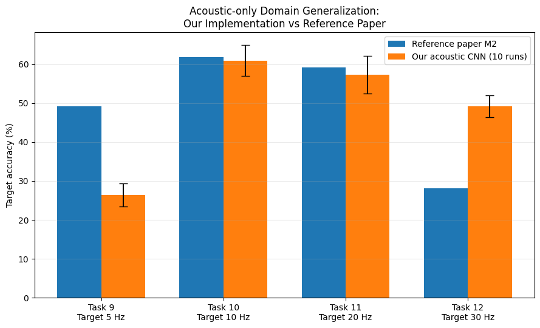
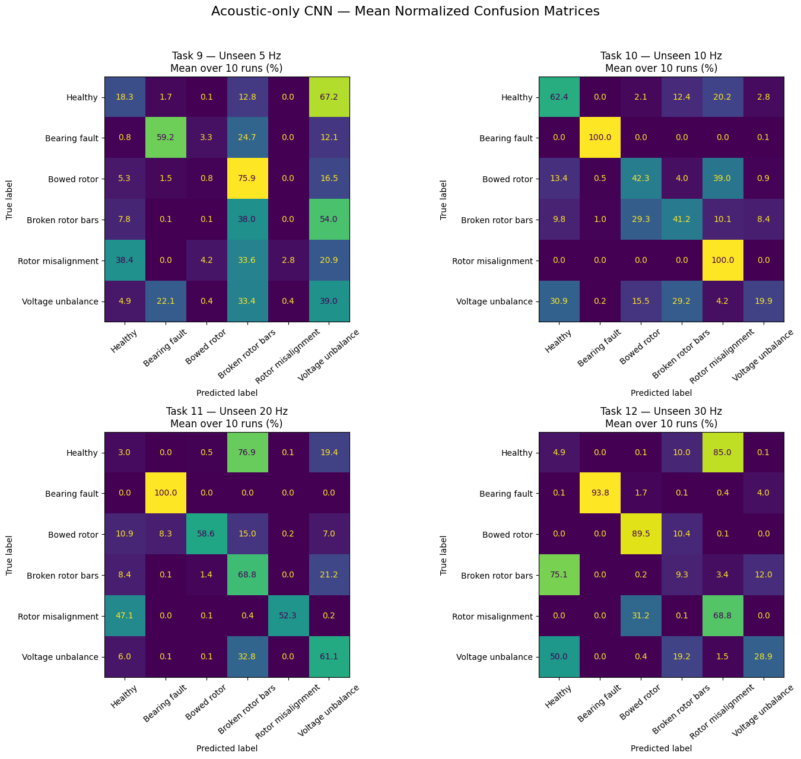
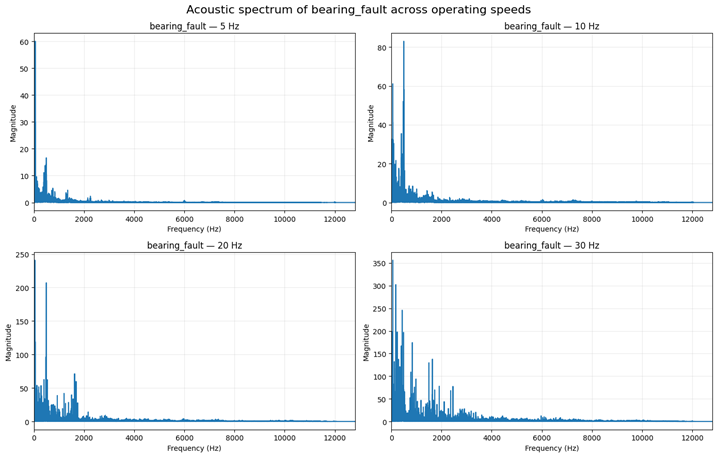
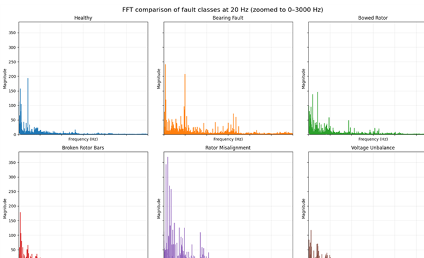

[](
https://colab.research.google.com/github/Sofianopoulou/hustmotor-acoustic-fault-diagnosis/blob/main/notebooks/HUSTmotor_Acoustic_Baseline.ipynb
)

# Acoustic Domain Generalization for Electrical Motor Fault Diagnosis

PyTorch implementation of an **acoustic-only 1D CNN baseline** for electrical motor fault diagnosis under **unseen operating speeds**.

This repository contains my acoustic-modality contribution to a multimodal deep-learning workshop project at the **Polytechnic University of Tirana (UPT)**. The broader project investigates motor fault diagnosis from synchronized vibration and acoustic signals using the HUSTmotor dataset.

The acoustic baseline follows the feature-extractor architecture and motor-domain generalization protocol described by Zhao et al. (2025). It is evaluated using leave-one-speed-out Tasks 9–12 across motor speeds of **5, 10, 20, and 30 Hz**.

> Although the broader workshop project uses the term *anomaly detection*, this baseline is a supervised **six-class fault-classification** experiment.

## Main result

Across **10 independent trials** and Tasks 9–12:

**Our acoustic CNN: 48.45 ± 2.14% average unseen-domain accuracy**

**Reference paper M2 acoustic baseline: 49.60%**

The similar overall averages hide substantial task-dependent differences:

| Task | Source speeds | Unseen target | Ours (10 runs) | Paper M2 |
|---|---|---:|---:|---:|
| 9 | 10, 20, 30 Hz | 5 Hz | **26.36 ± 3.00%** | 49.23% |
| 10 | 5, 20, 30 Hz | 10 Hz | **60.96 ± 4.02%** | 61.89% |
| 11 | 5, 10, 30 Hz | 20 Hz | **57.29 ± 4.88%** | 59.14% |
| 12 | 5, 10, 20 Hz | 30 Hz | **49.19 ± 2.80%** | 28.13% |

Task 9 shows a severe shift at unseen 5 Hz, while Task 12 substantially exceeds the reference M2 result. This task-level behavior is more informative than the global average alone.



## Class-wise analysis

The final evaluation reloaded all **40 trained checkpoints** (4 tasks × 10 seeds) and computed class-wise precision, recall, F1-score, and row-normalized confusion matrices.



Notable observations include:
- Task 9: bearing fault transfers moderately well, while bowed rotor, rotor misalignment, and healthy generalize poorly to 5 Hz.
- Task 10: bearing fault and rotor misalignment achieve very high recall, although rotor-misalignment precision remains lower.
- Task 11: healthy samples show a major domain-shift failure and are frequently mapped to broken rotor bars.
- Task 12: bearing fault and bowed rotor generalize strongly, while healthy and broken rotor bars remain difficult.

See [`docs/results.md`](docs/results.md) for a concise technical discussion.

## Repository structure

```text
.
├── README.md
├── LICENSE
├── CITATION.cff
├── requirements.txt
├── pyproject.toml
├── notebooks/
│   └── HUSTmotor_Acoustic_Baseline.ipynb
├── src/
│   └── acoustic_baseline/
│       ├── __init__.py
│       ├── data.py
│       ├── model.py
│       ├── training.py
│       └── evaluation.py
├── tests/
│   ├── test_model.py
│   └── test_training.py
├── results/
│   ├── acoustic_10runs_raw.csv
│   ├── acoustic_10runs_summary.csv
│   ├── acoustic_final_comparison_10runs.csv
│   ├── acoustic_class_metrics_10runs_summary.csv
│   └── ...
├── figures/
│   ├── acoustic_paper_vs_ours_10runs.png
│   ├── acoustic_confusion_matrices_10runs.png
│   └── ...
├── report/
│   ├── main.tex
│   ├── acoustic_baseline_report.pdf
│   └── figures/
└── docs/
    ├── methodology.md
    └── results.md
```

## Dataset and preprocessing

The original multimodal dataset is available from the dataset authors:

- [HUSTmotor Multi-Modal Dataset](https://github.com/CHAOZHAO-1/HUSTmotor-multi-modal-dataset)

The preprocessing pipeline used by this repository was prepared by **Gentian Qinami**:

- [ISCF Project — HUSTmotor preprocessing](https://github.com/Genti24-bit/ISCF_Project/)

The released `hustmotor_1024.npz` contains **24,000 paired 1024-point windows**:
- 6 health states
- 4 operating speeds
- 1,000 windows per class-speed pair
- synchronized vibration/acoustic indexing
- per-window z-score normalization
- block-based split metadata

The dataset file is intentionally **not committed to this repository**. The Colab notebook downloads the release and verifies its SHA-256 fingerprint before training.

### Important methodological difference

The reference paper describes a random **800/200** train/test split for each class-speed condition. The shared project preprocessing instead uses an **acquisition-block-based split** to reduce leakage between strongly related/overlapping windows.

For that reason, this work is described as a **paper-inspired reproduction / baseline implementation**, not a bit-for-bit reproduction of the authors' original code.

## Model

Each acoustic input has shape:

```text
(batch, 1, 1024)
```

The paper-inspired feature extractor is:

```text
Conv1D 1→16, kernel 64
BatchNorm + ReLU + MaxPool(2)

Conv1D 16→32, kernel 16
BatchNorm + ReLU + MaxPool(2)

Conv1D 32→64, kernel 5
BatchNorm + ReLU + MaxPool(2)

Conv1D 64→64, kernel 5
BatchNorm + ReLU + MaxPool(2)

Flatten
Linear → 6 classes
```

This implementation uses `padding=0` because convolution padding is not explicitly reported in the paper. With valid convolutions, the final feature map has shape `(64, 55)`, producing a **3520-dimensional acoustic representation** before the classifier.

During training, the network returns raw logits and uses `torch.nn.CrossEntropyLoss`. Softmax is applied only when explicit class probabilities are required.

## Training protocol

- Framework: PyTorch
- Optimizer: Adam
- Epochs: 50
- Batch size: 256
- Seeds: 0–9 for final evaluation
- Learning rate:

\[
lr = \frac{0.0005}{(1 + 10p)^{0.75}},
\]

where \(p\) is the ratio of current epoch to total epochs.

Model selection is performed using **source-domain validation data only**. The unseen target speed is evaluated only after checkpoint selection.

## Quick start

### Google Colab

The easiest reproduction path is:

1. Open [`notebooks/HUSTmotor_Acoustic_Baseline.ipynb`](notebooks/HUSTmotor_Acoustic_Baseline.ipynb) in Google Colab.
2. Enable GPU acceleration.
3. Run the notebook from top to bottom.
4. Set `RUN_10_TRIALS = True` only after the single-run Tasks 9–12 experiment works correctly.

The notebook automatically:
- mounts Google Drive;
- creates project folders;
- clones the preprocessing repository;
- downloads and hash-verifies the processed dataset;
- trains Tasks 9–12;
- saves checkpoints and CSV results;
- re-evaluates the 40 checkpoints for aggregate metrics.

### Local Python

```bash
git clone <your-repository-url>
cd hustmotor-acoustic-domain-generalization

python -m venv .venv
source .venv/bin/activate          # Windows: .venv\Scripts\activate
pip install -r requirements.txt

pytest
```

The modular source code in `src/acoustic_baseline/` mirrors the core model/training logic from the notebook.

## Exploratory acoustic analysis

Before modeling, acoustic FFT comparisons were used to examine:
1. the same fault across different speeds;
2. different faults at the same speed.





These observations motivated the domain-generalization setting: acoustic signals contain fault-discriminative information, but their spectral structure is also strongly affected by operating speed.

## Report

A two-column academic report documenting the implementation, experimental design, results, limitations, and relation to the multimodal stage is included in [`report/`](report/).

- [LaTeX source](report/main.tex)
- [Compiled PDF](report/acoustic_baseline_report.pdf)

## References

**Reference paper**

C. Zhao, W. Shen, E. Zio, and H. Ma,  
“Multimodal unified generalization and translation network for intelligent fault diagnosis under dynamic environments,”  
*Engineering Applications of Artificial Intelligence*, vol. 162, 112559, 2025.  
https://doi.org/10.1016/j.engappai.2025.112559

**Dataset**

[CHAOZHAO-1/HUSTmotor-multi-modal-dataset](https://github.com/CHAOZHAO-1/HUSTmotor-multi-modal-dataset)

**Preprocessing used by the project**

[Genti24-bit/ISCF_Project](https://github.com/Genti24-bit/ISCF_Project/)

## Attribution

This repository contains **my acoustic-branch implementation and evaluation**. Dataset collection and upstream preprocessing are credited to their respective authors/contributors above.

The MIT license in this repository applies to original code authored for this repository. Third-party datasets, publications, and external repositories remain subject to their own licenses and terms.
