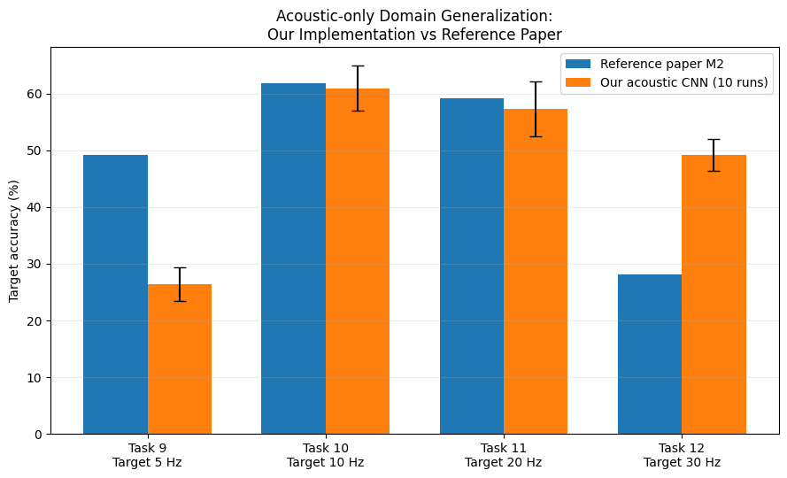
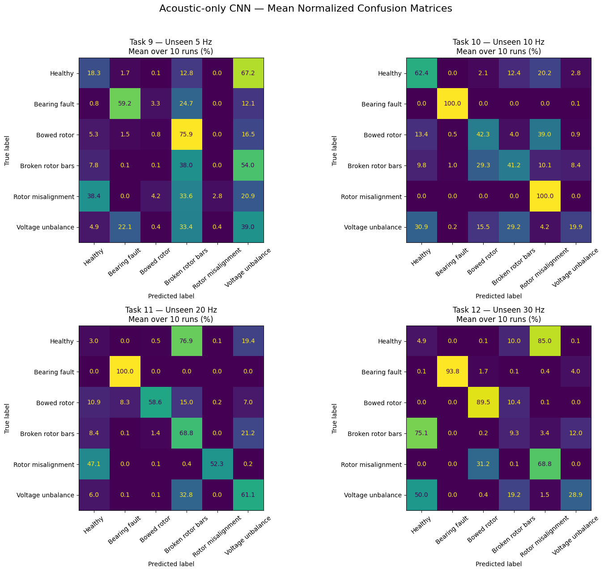
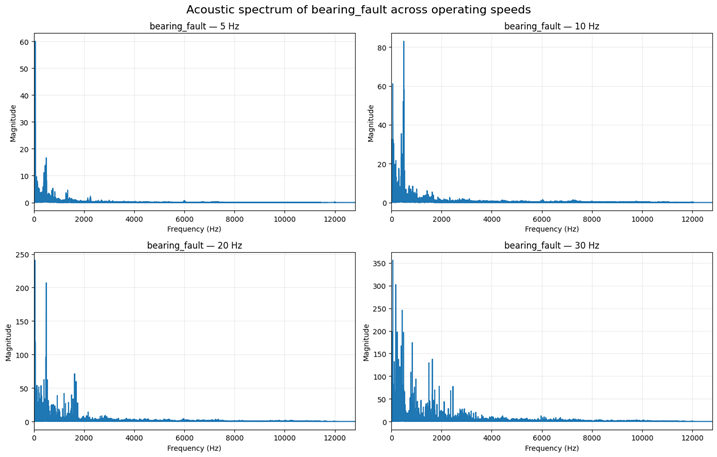
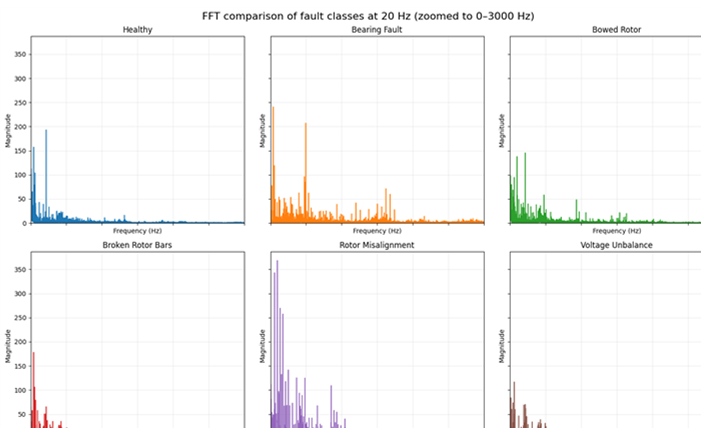

**Open in Google Colab**

- **Z-score baseline:** [](https://colab.research.google.com/github/Sofianopoulou/hustmotor-acoustic-fault-diagnosis/blob/main/notebooks/HUSTmotor_Acoustic_Baseline.ipynb)
- **RMS experiment:** [](https://colab.research.google.com/github/Sofianopoulou/hustmotor-acoustic-fault-diagnosis/blob/main/notebooks/HUSTmotor_Acoustic_RMS.ipynb)

# Acoustic Domain Generalization for Electrical Motor Fault Diagnosis

PyTorch implementation and preprocessing comparison of an **acoustic-only 1D CNN** for electrical motor fault diagnosis under **unseen operating speeds**.

This repository contains my acoustic-modality contribution to a multimodal deep-learning workshop project at the **Université de technologie de Compiègne (UTC)**. The broader project investigates motor fault diagnosis using synchronized vibration and acoustic signals from the HUSTmotor dataset.

The acoustic CNN follows a paper-inspired architecture and the leave-one-speed-out motor-domain generalization protocol described by Zhao et al. (2025), across **5, 10, 20 and 30 Hz**. Two acoustic input normalization strategies have been evaluated: **per-window z-score** and **source-trained RMS**.

> Although the broader workshop project uses the term *anomaly detection*, this baseline is a supervised **six-class fault-classification** experiment.

## Results: z-score vs RMS normalization

Each result is the **mean unseen-target accuracy over 10 independent seeds** for the corresponding leave-one-speed-out task.

| Task | Source speeds | Unseen speed | Z-score (mean ± SD) | RMS (mean ± SD) | Paper M2 |
|---|---|---|---:|---:|---:|
| 9 | 10, 20, 30 Hz | 5 Hz | 26.36 ± 3.00% | 24.68 ± 6.61% | 49.23% |
| 10 | 5, 20, 30 Hz | 10 Hz | 60.96 ± 4.02% | 44.88 ± 2.29% | 61.89% |
| 11 | 5, 10, 30 Hz | 20 Hz | 57.29 ± 4.88% | 41.14 ± 4.32% | 59.14% |
| 12 | 5, 10, 20 Hz | 30 Hz | 49.19 ± 2.80% | 42.04 ± 7.56% | 28.13% |
| **Overall** | — | — | **48.45 ± 2.14%** | **38.19 ± 2.34%** | **49.60%** |

*Overall SD is computed across the 10 seed-wise averages of the four target tasks; it is not the pooled SD of all 40 accuracies. Percentage figures are rounded.*

**Observation:** RMS normalization yielded **10.26 percentage points lower overall mean target accuracy** than the z-score baseline. Performance decreased on all four tasks, with the largest changes on Tasks 10 and 11. A possible explanation is that preserving relative acoustic amplitude makes the classifier more sensitive to motor-speed-dependent variation, but this mechanism has not yet been established experimentally.

**Comparison caveat:** The original z-score notebook uses the v1.0 processed dataset, while the RMS notebook uses v1.3. The shared preprocessing documentation states that these contain the same signals and partitions, but an independent array-level equivalence check of the two versioned files and a full configuration comparison are still needed before treating normalization as the *sole* cause of the accuracy difference.

**Reference paper:** The published M2 results use a different splitting approach, so they provide context rather than a strictly controlled benchmark.

### Z-score baseline figures



The existing plots in `figures/` and analysis in `docs/results.md` relate to the **original z-score baseline**, not the new RMS experiment. RMS training outputs, checkpoint files, plots and additional evaluation artifacts are stored in the associated Google Drive experiment directory and displayed in the RMS notebook.

## Class-wise analysis (original z-score baseline)

The original z-score evaluation reloaded all **40 trained checkpoints** (4 tasks × 10 seeds) and computed class-wise precision, recall, F1-score, and row-normalized confusion matrices.



Notable observations include:
- Task 9: bearing fault transfers moderately well, while bowed rotor, rotor misalignment, and healthy generalize poorly to 5 Hz.
- Task 10: bearing fault and rotor misalignment achieve very high recall, although rotor-misalignment precision remains lower.
- Task 11: healthy samples show a major domain-shift failure and are frequently mapped to broken rotor bars.
- Task 12: bearing fault and bowed rotor generalize strongly, while healthy and broken rotor bars remain difficult.

See [`docs/results.md`](docs/results.md) for a concise technical discussion.

## Repository structure

```text
.
├── README.md
├── LICENSE
├── CITATION.cff
├── requirements.txt
├── pyproject.toml
├── notebooks/
│   ├── HUSTmotor_Acoustic_Baseline.ipynb
│   └── HUSTmotor_Acoustic_RMS.ipynb
├── src/
│   └── acoustic_baseline/
│       ├── __init__.py
│       ├── data.py
│       ├── model.py
│       ├── training.py
│       └── evaluation.py
├── tests/
│   ├── test_model.py
│   └── test_training.py
├── results/
│   ├── acoustic_10runs_raw.csv
│   ├── acoustic_10runs_summary.csv
│   ├── acoustic_final_comparison_10runs.csv
│   ├── acoustic_class_metrics_10runs_summary.csv
│   └── ...
├── figures/
│   ├── acoustic_paper_vs_ours_10runs.png
│   ├── acoustic_confusion_matrices_10runs.png
│   └── ...
├── report/
│   ├── main.tex
│   ├── acoustic_baseline_report.pdf
│   └── figures/
└── docs/
    ├── methodology.md
    └── results.md
```

## Dataset and preprocessing

The original multimodal dataset is available from the dataset authors:

- [HUSTmotor Multi-Modal Dataset](https://github.com/CHAOZHAO-1/HUSTmotor-multi-modal-dataset)

The preprocessing pipeline used by this repository was prepared by **Gentian Qinami**:

- [ISCF Project — HUSTmotor preprocessing](https://github.com/Genti24-bit/ISCF_Project/)

The processed dataset contains **24,000 paired 1024-point windows**. The z-score baseline uses `hustmotor_1024.npz` (v1.0); the RMS notebook uses `hustmotor_1024_v1.3.npz` (v1.3):
- 6 health states
- 4 operating speeds
- 1,000 windows per class-speed pair
- synchronized vibration/acoustic indexing
- stored per-window z-score-normalized waveforms
- block-based split metadata
- v1.3: per-window RMS values, DC offsets, start indices, and 11 time-domain features for both acoustic and vibration signals

Dataset archives and model checkpoints are intentionally **not committed to this repository**. Each Colab notebook downloads or accesses its specified dataset and verifies the relevant SHA-256 fingerprint.

### Normalization methods

- **Z-score:** Each window is centered and divided by its own standard deviation. This removes relative amplitude differences across windows.
- **RMS:** Using the v1.3 metadata, the shared loader reconstructs DC-removed windows and divides each by a **single channel-specific RMS scale derived only from source-training windows for that task**. This retains between-window amplitude differences without using target-domain data to set the scale.

Both notebooks use the same six-class classification objective and leave-one-speed-out evaluation design. The RMS notebook explicitly passes `norm="rms"` during training and final checkpoint evaluation.

### Important methodological difference

The reference paper describes a random **800/200** train/test split for each class-speed condition. The shared project preprocessing instead uses an **acquisition-block-based split** to reduce leakage between strongly related/overlapping windows.

For that reason, this work is described as a **paper-inspired reproduction / baseline implementation**, not a bit-for-bit reproduction of the authors' original code.

## Model

Each acoustic input has shape:

```text
(batch, 1, 1024)
```

The paper-inspired feature extractor is:

```text
Conv1D 1→16, kernel 64
BatchNorm + ReLU + MaxPool(2)

Conv1D 16→32, kernel 16
BatchNorm + ReLU + MaxPool(2)

Conv1D 32→64, kernel 5
BatchNorm + ReLU + MaxPool(2)

Conv1D 64→64, kernel 5
BatchNorm + ReLU + MaxPool(2)

Flatten
Linear → 6 classes
```

This implementation uses `padding=0` because convolution padding is not explicitly reported in the paper. With valid convolutions, the final feature map has shape `(64, 55)`, producing a **3520-dimensional acoustic representation** before the classifier.

During training, the network returns raw logits and uses `torch.nn.CrossEntropyLoss`. Softmax is applied only when explicit class probabilities are required.

## Training protocol

- Framework: PyTorch
- Optimizer: Adam
- Epochs: 50
- Batch size: 256
- Seeds: 0–9 for final evaluation
- Learning rate:

\[
lr = \frac{0.0005}{(1 + 10p)^{0.75}},
\]

where \(p\) is the ratio of current epoch to total epochs.

Model selection is performed using **source-domain validation data only**. The unseen target speed is evaluated only after checkpoint selection.

## Quick start

### Google Colab

1. Choose the [z-score baseline notebook](notebooks/HUSTmotor_Acoustic_Baseline.ipynb) or the [RMS notebook](notebooks/HUSTmotor_Acoustic_RMS.ipynb).
2. Open it in Colab, enable a GPU runtime, and mount Google Drive when prompted.
3. Run the setup and data-loading cells, then the single-run experiment if you want to reproduce training.
4. Only set `RUN_10_TRIALS = True` if you intend to train all **40 models** (four tasks × ten seeds). The completed RMS notebook defaults to `False` to avoid accidentally overwriting checkpoints.
5. For aggregate evaluation without retraining, ensure the saved checkpoints exist in the Drive location specified in the notebook, then run the checkpoint evaluation cells.

The notebooks provide code that:
- mounts Google Drive;
- creates project folders;
- clones the preprocessing repository;
- downloads and hash-verifies the processed dataset;
- trains Tasks 9–12;
- saves checkpoints and CSV results;
- re-evaluates the 40 checkpoints for aggregate metrics.

### Local Python

```bash
git clone https://github.com/Sofianopoulou/hustmotor-acoustic-fault-diagnosis.git
cd hustmotor-acoustic-fault-diagnosis

python -m venv .venv
source .venv/bin/activate          # Windows: .venv\Scripts\activate
pip install -r requirements.txt

pytest
```

The modular source code in `src/acoustic_baseline/` mirrors the core model/training logic from the original baseline. The RMS experiment and its normalization-specific checkpoint evaluation are documented in the dedicated notebook.

## Exploratory acoustic analysis

Before modeling, acoustic FFT comparisons were used to examine:
1. the same fault across different speeds;
2. different faults at the same speed.





These observations motivated the domain-generalization setting: acoustic signals contain fault-discriminative information, but their spectral structure is also strongly affected by operating speed.

## Report

The existing report documents the **original z-score baseline**. It predates the RMS comparison and should not be interpreted as reporting RMS results.

A two-column academic report documenting the implementation, experimental design, results, limitations, and relation to the multimodal stage is included in [`report/`](report/).

- [LaTeX source](report/main.tex)
- [Compiled PDF](report/acoustic_baseline_report.pdf)

## References

**Reference paper**

C. Zhao, W. Shen, E. Zio, and H. Ma,  
“Multimodal unified generalization and translation network for intelligent fault diagnosis under dynamic environments,”  
*Engineering Applications of Artificial Intelligence*, vol. 162, 112559, 2025.  
https://doi.org/10.1016/j.engappai.2025.112559

**Dataset**

[CHAOZHAO-1/HUSTmotor-multi-modal-dataset](https://github.com/CHAOZHAO-1/HUSTmotor-multi-modal-dataset)

**Preprocessing used by the project**

[Genti24-bit/ISCF_Project](https://github.com/Genti24-bit/ISCF_Project/)

## Attribution

This repository contains **my acoustic-branch implementation and evaluation**. Dataset collection and upstream preprocessing are credited to their respective authors/contributors above.

The MIT license in this repository applies to original code authored for this repository. Third-party datasets, publications, and external repositories remain subject to their own licenses and terms.
